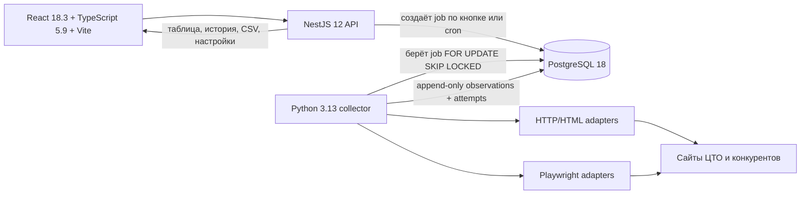

# План разработки прототипа мониторинга цен конкурентов

Версия: 01.11.2026
Репозиторий: `competitor-price-tracker`
Цель: за 3 дня получить воспроизводимый прототип по требованиям `ZADANIE.md`, пригодный для демонстрации за 10 минут и последующего встраивания в инфраструктуру ЦТО.

## 1. Зафиксированные решения и границы

### Подтверждено руководителем

1. `modeli-dop.csv` можно включить. В базу импортируем все 238 дополнительных позиций, но обязательное качество сбора сначала обеспечиваем для 29 основных. Для дополнительных товаров собственная цена может оставаться пустой до загрузки компанией.
2. Отсутствие карточки комплекта `NORDBERG 4641N + ROSSVIK VT-64` на сайте допустимо. Это не ошибка импорта.
3. Автоматический сбор запускается один раз в сутки. Расписание должно быть настраиваемым.

Источник этих решений — ответ руководителя в Telegram от 30.10.2026. Скриншот служит подтверждением решений, но не хранится в Git: в нём есть лишние данные интерфейса и контакта.

### Не подтверждено и не должно быть зашито как факт

- целевой регион, НДС, доставка, монтаж, пусконаладка, наличие/под заказ;
- РРЦ или фактическая цена продажи как главный официальный ориентир;
- минимальное число конкурентов на товар и достаточное покрытие;
- срок актуальности наблюдения;
- разрешено ли составлять конкурентный комплект из компонентов разных продавцов;
- точные собственные URL и цена компонентов `4641N` и `VT-64.5005`.

До ответа используются явные настройки: `region=Москва`, `timezone=Europe/Moscow`, неизвестные условия хранятся как `null`, а политика комплекта — `same_seller_only`. Переключатель `allow_cross_seller_bundle=false` можно предусмотреть в доменной логике, но нельзя включать в демонстрационный расчёт без подтверждения.

## 2. Почему не стоит начинать только с базы данных

PostgreSQL 18 действительно должен быть первым техническим компонентом. Перед его подъёмом нужен короткий этап 0: зафиксировать сущности, правила сопоставления, границы MVP и структуру репозитория. Иначе миграции придётся менять из-за:

- append-only истории наблюдений;
- разницы между товаром, предложением продавца и полученной ценой;
- официального приоритета и разных типов цены;
- ручных наблюдений и сомнительных предложений;
- составного товара;
- ежедневных заданий, частичных сбоев и повторов.

Поэтому первый milestone включает контракт данных, Docker Compose, PostgreSQL 18 и первую forward-only SQL-миграцию. Это будет первый реализационный коммит после планирования.

## 3. Архитектура MVP



PostgreSQL используется и как хранилище, и как простая очередь заданий. Redis, RabbitMQ, Celery и другие службы не добавляются. Сбой одного источника создаёт неуспешную попытку только для этого источника; остальные продолжают работу.

### Предлагаемая структура

```text
competitor-price-tracker/
  AGENTS.md
  .env.example
  compose.yaml
  Makefile
  data/
    input/modeli.csv
    input/modeli-dop.csv
    research/model-registry.json
  docs/
    DEVELOPMENT_PLAN.md
    RESEARCH.md
    DEMO.md
    AI_USAGE.md
  infra/
    db/migrations/001_initial.sql
    db/migrations/002_*.sql
  apps/
    api/                 # NestJS 12, Prisma 7, zod 4
    web/                 # React 18.3, TS 5.9, Vite
  collector/
    pyproject.toml       # Python 3.13
    src/
      domain/
      sources/
      worker/
    tests/
  tests/
    fixtures/
    acceptance/
```

Prisma не управляет DDL. Схема создаётся только пронумерованными SQL-миграциями вперёд; `prisma generate` даёт типизированный клиент поверх уже созданной схемы. Rollback-миграции в MVP не добавляются.

## 4. Минимальная модель данных

- `products`: собственный товар, артикул, название, URL ЦТО, приоритет, обязательный/дополнительный, активность мониторинга.
- `product_specs`: существенные характеристики для сопоставления; исходное значение, нормализованное значение и единица.
- `product_components`: компоненты комплекта и количество; для 4641N + VT-64 — две строки.
- `sellers`: продавец/юрлицо, география и проверенный статус.
- `sources`: домен, тип источника, официальный статус и доказательство, метод сбора, лимит частоты, включённость.
- `offers`: связь точного товара с карточкой продавца, URL, артикул продавца, статус совпадения и причина проверки.
- `collection_jobs`: ручной или плановый запуск, состояние, время и сводка.
- `collection_attempts`: попытка по источнику/offer, длительность, HTTP/браузер, ошибка и номер повтора.
- `price_observations`: каждое успешное получение цены отдельной строкой; обновления и удаления запрещены триггером.
- `app_settings`: cron, timezone и безопасные бизнес-настройки.
- SQL-view `current_valid_prices`: последнее надёжное наблюдение по offer без перезаписи истории.
- SQL-view `comparison_candidates`: только точные совпадения с нормализованной ценой за единицу; сомнительные остаются видимыми в истории, но не попадают в итог.

В `price_observations` нужны: исходная и нормализованная цена, валюта, количество/единица, тип цены (`rrp|retail|sale|quote|unknown`), НДС, наличие, регион, доставка/монтаж, `observed_at`, `received_at`, `method=auto|manual`, надёжность, причина исключения, raw-фрагмент/структурированное доказательство и версия коллектора.

Повторный ежедневный сбор добавляет наблюдение даже при неизменной цене. Так видна свежесть источника и факт успешного запуска.

## 5. Правила сравнения как код

Правила реализуются чистыми функциями до адаптеров сайтов:

1. Совпадают бренд, модель/артикул и все существенные характеристики: напряжение, диапазоны, поколение, цвет/комплектация там, где это определяет SKU.
2. Цена нормализуется к одной штуке только при известном количестве одинаковых единиц. Неоднородный набор не делится.
3. Цена производителя или подтверждённого официального дилера получает приоритет, но РРЦ и фактическая розница не смешиваются.
4. `от`, устаревшая страница, неточная модель и конфликт характеристик получают `unreliable`/причину исключения и не входят в итог.
5. Ручная цена всегда содержит `method=manual`.
6. Комплект считается как сумма компонентов. По умолчанию оба конкурентных компонента должны относиться к одному seller; отсутствие собственной карточки комплекта допускается.
7. Неизвестное условие хранится как `null`, а не как ноль, `false` или «включено».

На эти правила нужны unit- и property-based тесты; для известных конфликтов из исследования — отдельные regression fixtures.

### Добор источников после первоначального маркет-анализа

Первоначальный маркет-анализ остаётся исходной точкой и аудиторским следом. Дополнительные конкуренты и резервные карточки подбираются только после фактической проверки исходных источников. Причинами добора могут быть конфликт характеристик, другая комплектация или поколение, отсутствие открытой цены, CAPTCHA, авторизация, нестабильная вёрстка либо недостаточные доказательства exact match.

Новый источник не заменяет первоначальный молча. В системе и финальном отчёте хранятся оба источника с полями:

- роль `initial|added|reserve` и причина добавления;
- продавец, URL, точный артикул и дата проверки;
- совпавшие и конфликтующие существенные характеристики;
- тип цены, наличие, НДС и неизвестные коммерческие условия;
- доверие к идентичности товара, доверие к цене и надёжность автоматического сбора;
- итог `exact|review|unreliable` и явная причина исключения.

Доверие оценивается раздельно. Производитель, импортёр или подтверждённый официальный канал относится к классу A; профильный продавец с полным точным SKU и открытой ценой — к классу B; противоречивый или неполный кандидат — к классу C. Класс A не превращает другую конфигурацию в точное совпадение. Класс B может дать фактическую розничную цену, но не отменяет конфликт с паспортом производителя. Класс C сохраняется для аудита и не входит в сравнение.

Надёжный исходный источник имеет приоритет над добавленным резервом. Резерв используется, когда основной источник недоступен или не даёт валидного наблюдения, и только при том же exact-профиле. РРЦ, розничная, акционная цена и цена по запросу остаются разными типами наблюдений.

Результаты второго прохода по 11 спорным моделям зафиксированы в `docs/SOURCE_EXPANSION_AUDIT.md`: шесть моделей получили безопасные точные источники и переведены в автоматический сбор, одна оставлена на проверке поколения и четыре требуют паспорта или коммерческой спецификации.

## 6. Секреты и конфигурация

Реальный `.env` создаётся локально перед первым запуском и никогда не коммитится. В GitHub попадает только `.env.example` с безопасными заглушками:

```dotenv
POSTGRES_DB=price_monitor
POSTGRES_USER=price_monitor
POSTGRES_PASSWORD=replace_with_random_32_plus_chars
DATABASE_URL=postgresql://price_monitor:replace_with_random_32_plus_chars@db:5432/price_monitor
APP_TIMEZONE=Europe/Moscow
COLLECTION_CRON=0 3 * * *
API_PORT=3000
WEB_PORT=5173
COLLECTOR_POLL_SECONDS=5
COLLECTOR_REQUEST_TIMEOUT_SECONDS=20
COLLECTOR_MAX_RETRIES=3
COLLECTOR_RATE_LIMIT_PER_HOST=1
VITE_API_BASE_URL=http://localhost:3000
TELEGRAM_BOT_TOKEN=
TELEGRAM_CHAT_ID=
```

Перед коммитом:

- дополнить `.gitignore`: `.env`, `.env.*`, исключение `!.env.example`;
- сгенерировать пароль криптографическим генератором, не моделью;
- проверить `git status`, `git diff --cached` и поиск типовых секретов;
- не выводить DSN, токены и содержимое `.env` в логи;
- не добавлять `OPENAI_API_KEY`: OpenAI-модели помогают разрабатывать, но не являются runtime-зависимостью продукта.

Telegram-переменные остаются пустыми, пока обязательная часть не принята.

## 7. Этапы, проверки и коммиты

### Этап 0. Контракт и каркас репозитория

Результат:

- `AGENTS.md`, этот план, исследование и решения руководителя;
- каталоги проекта, `.editorconfig`, обновлённый `.gitignore`, `.env.example`;
- зафиксированные версии runtimes и менеджеров пакетов;
- копии обоих CSV в `data/input`, без изменения исходников;
- схема архитектуры и список нерешённых бизнес-вопросов.

Проверка: репозиторий не содержит секретов; CSV читаются в UTF-8; 29 и 238 строк подтверждены; план не обещает неподтверждённые цены.

Коммит: `docs: define MVP architecture and business invariants`.

### Этап 1. PostgreSQL 18 и forward-only migrations

Результат:

- `compose.yaml` с PostgreSQL 18 и healthcheck;
- migration service/скрипт, выполняющий только ещё не применённые `NNN_*.sql`;
- начальная схема из раздела 4;
- append-only триггер для `price_observations`;
- индексы по `product_id`, `offer_id`, `observed_at`, состоянию job;
- Prisma 7 schema/client, отражающие SQL-схему.

Проверка:

1. запуск с пустого volume;
2. повторный запуск миграций идемпотентен;
3. попытки UPDATE/DELETE наблюдения завершаются ошибкой;
4. `docker compose up db migrate` получает healthy;
5. Prisma и Python подключаются к одной схеме.

Коммит: `feat(db): add PostgreSQL schema and forward-only migrations`.

### Этап 2. Импорт каталога и seed research

Результат:

- валидатор/importer `modeli.csv` и `modeli-dop.csv`;
- 29 основных товаров активны, 238 дополнительных загружены с более низким приоритетом;
- собственная цена дополнительных товаров допускает `null`;
- комплект создан как product + два component;
- seed продавцов, sources и offers из `model-registry.json` без объявления непроверенных ссылок точными.

Проверка: повторный импорт не создаёт дублей; отчёт показывает 29/238; 28 собственных URL у основных; комплект без URL проходит валидацию; кодировка и кавычки CSV не ломаются.

Коммит: `feat(catalog): import required and additional product lists`.

### Этап 3. Домен сопоставления и надёжности

Результат:

- чистые типы/функции сравнения;
- нормализация денег и единиц;
- official-source priority;
- ручной ввод;
- bundle policy;
- fixtures для ES-26D, 4523PA1, VT-61, GL10, T300/380 и 4641N + VT-64.

Проверка: тесты всех правил 1–5 из ТЗ и дополнительных ограничений исследования; похожая модель никогда не проходит exact match; неоднородный комплект не делится.

Коммит: `feat(domain): enforce matching and price reliability rules`.

### Этап 4. Каркас Python-коллектора

Результат:

- Python 3.13 worker, забирающий jobs через `FOR UPDATE SKIP LOCKED`;
- общий контракт source adapter;
- HTTP client с timeout, exponential backoff, rate limit per host и идентифицируемым User-Agent;
- Playwright adapter для динамических страниц;
- общий rate limit per host для HTTP и Playwright, чтобы браузерный fallback не создавал лишний запрос вне ограничения;
- независимые attempts и частичный успех job;
- сохранение evidence и ручной fallback без обхода CAPTCHA/авторизации.

Проверка: fake sources моделируют timeout, 429, 500, неверную цену и падение одного источника; другие источники завершаются; число повторов ограничено; нет бесконечных job. Отдельный Docker smoke-test запускает реальный Chromium на локальной динамической странице и подтверждает получение состояния после JavaScript.

Коммит: `feat(collector): add resilient source worker and adapter contract`.

### Этап 5. Первые реальные источники

Приоритет для демонстрации:

1. `centr-to.ru` — собственная цена и характеристики;
2. `si-tools.ru` — T300/380, наиболее подготовленная точная пара;
3. один подтверждённый канал NORDBERG;
4. `rossvik.moscow`/подтверждённый ROSSVIK-источник для VT-63;
5. один коммерчески важный многобрендовый продавец — РусТехника или Все Для СТО.

Каждый adapter реализуется только после ручной фиксации exact SKU и HTML/JSON-LD fixture. Сначала HTTP/структурированные данные; Playwright только если это действительно требуется. Marketplace и защищённый источник не должны отнимать время у работающего MVP: для них остаётся ручной метод.

После базовых адаптеров выполняется контролируемый добор по правилам раздела 5. Сначала реализуются подтверждённые ES-950, ROSSVIK V-26, NORDBERG 4523C, ROSSVIK V-524, ROSSVIK VT-61 и Guangli GL3. NORDBERG 4523PA1(B) остаётся исключённым до подтверждения поколения. ES-26D, Guangli GL2, GL3 LUX и GL10 не получают фиктивный exact match ради покрытия.

Проверка: две последовательные записи на fixture и один контролируемый live smoke-test; корректные модель, цена, единица и timestamp; изменение вёрстки даёт явную ошибку, а не нулевую цену. Live-тест не является обязательным тестом CI.

Коммиты по источникам, например:

- `feat(source): collect own prices from centr-to`
- `feat(source): collect T300 price from si-tools`
- `feat(source): add verified Nordberg and Rossvik offers`

### Этап 6. NestJS API, кнопка и ежедневное расписание

Результат:

- endpoints товаров, текущего сравнения, истории, jobs, ручных наблюдений, CSV и health;
- `POST /collection-jobs` создаёт ручной job и быстро возвращает ID;
- scheduler создаёт один daily job по `COLLECTION_CRON`;
- защита от двух одновременно запущенных daily jobs;
- zod 4 validation на границах;
- timezone хранится явно.

Проверка: ручной и scheduled job идут одним кодовым путём; повторный cron не создаёт дубль; API показывает partial success; неверный ручной ввод отклоняется; API не меняет историю.

Коммит: `feat(api): add collection orchestration, history and export endpoints`.

### Этап 7. React-интерфейс

Результат:

- таблица: модель, наша цена, цены конкурентов, разница ₽/%, источник, дата, надёжность;
- сортировка, скрытие/показ столбцов;
- фильтры exact/review/unreliable и required/additional;
- кнопка сбора с состоянием job;
- история товара;
- светлая/тёмная тема;
- пустые, loading, partial failure и error states;
- desktop-first, базовая мобильная проверка.

Проверка: component tests, typecheck, production build; визуальный осмотр desktop/mobile; неизвестные данные показываются как «не указано», а не 0; сомнительная цена не окрашивается как выгодное предложение.

Коммит: `feat(web): add comparison dashboard and collection controls`.

### Этап 8. CSV и история

Результат: CSV с точными столбцами ТЗ:
`model,nash_url,konkurent,konkurent_url,cena,cena_za,data_sbora,sposob,nadezhnost,kommentariy`.

Проверка: UTF-8, корректное экранирование запятых/кавычек/переносов; ручной метод виден; история содержит две одинаковые цены с разными датами после двух сборов; экспорт открывается и повторно парсится тестом.

Коммит: `feat(export): add required CSV and append-only price history`.

### Этап 8.5. Дополнительный анализ спорных моделей

`NORDBERG 4523PA1(B)` закрыт 02.11.2026 после обновления карточки ЦТО, подтверждения конфигурации 10–28 и успешного автоматического сбора 222 000 ₽ с официального сайта. Перед финальной приёмкой остаётся отдельный ограниченный повторный анализ моделей `ES-26D`, `Guangli GL2`, `Guangli GL3 LUX` и `Guangli GL10`.

Цель этапа — дать владельцу проекта возможность получить паспорт, фото шильдика, коммерческую спецификацию или ответ производителя и проверить, снимает ли новый документ зафиксированный конфликт поколения, массы, мощности, света или толщины стен. Поиск новых продавцов сам по себе не считается достаточным доказательством, если они повторяют противоречивую таблицу без первичного документа.

Результат по каждой модели:

- таблица `характеристика ЦТО / кандидат / первичный документ`;
- ссылка и дата проверки каждого доказательства;
- решение `exact`, `review` или `unreliable` с объяснением;
- при `exact` — fixture, профиль критичных характеристик, тест и контролируемый live smoke-test;
- при отсутствии доказательства — модель остаётся исключённой без фиктивной цены.

Проверка: ни одна из четырёх оставшихся моделей не переводится в точное совпадение только по одинаковому названию или скопированной несколькими продавцами таблице.

Если на следующих контрольных запусках сохраняются технические ошибки, в этот же этап входит повторная работа с карточкой VT-63 на `rossvik.moscow`, карточкой 46TRKE56(B) на `tmktools.ru` и тремя защищёнными страницами `rustehnika.ru`. Сначала проверяются актуальность URL, редиректы, новая разметка и наличие открытой цены. Затем подбирается точный резерв с тем же SKU и критичными характеристиками. CAPTCHA и авторизация не обходятся. Если безопасного автоматического канала нет, сохраняются последняя надёжная цена, дата наблюдения и явное ограничение в отчёте.

Первый контрольный запуск `nordberg-shop.ru` был успешным, но два следующих полных запуска 02.11.2026 завершились browser timeout по его активным карточкам. Поэтому источник не удалён, а понижен до `review`. Рабочие exact-каналы заменены на АВТОСЕРВИС2 и Оптима-Трейд для станков, а для STANDART — на МАСТАК. Это сохраняет аудиторский след и убирает повторяющиеся таймауты из ежедневной очереди.

Оставшаяся техническая работа выполняется в таком порядке:

1. `rossvik.moscow / VT-63` — закрыто 02.11.2026. Основным источником выбран `autoservice2.ru`, резервом `atsgroup.su`. Оба совпадают по VT-63.5005, 220 В, LCD, лазеру, УЗ и RAL5005. АТС прошёл JSON-LD и полный qualifier smoke-test. Топ Мастер сохранён как review после двух browser timeout.
2. `tmktools.ru / 46TRKE56(B)` — закрыто 02.11.2026. После повторного успешного запуска точный `carmod.ru` повышен до основного рабочего источника, а TMK без открытой цены переведён в неактивный аудит с сохранением URL и истории.
3. Три `rustehnika.ru` — закрыто 02.11.2026. После второго подтверждающего запуска точные открытые карточки повышены до основных, а защищённые дубли выключены только из ежедневной автоматической очереди. URL, причины совпадения и прежние наблюдения остаются в аудите. Допустима редкая ручная проверка доступности без попытки пройти CAPTCHA. Обход проверки человека не разрабатывается.
4. Дополнительный анализ четырёх спорных моделей остаётся обязательным перед финальной приёмкой. Упрощение интерфейса из этапа 8.6 выполнено раньше по решению владельца проекта и уже не блокирует этот анализ.

Полный повторный проход по всем 29 обязательным моделям выполнен 02.11.2026 и зафиксирован в `docs/FULL_MARKET_COVERAGE_AUDIT.md`. После последнего расширения в базе 64 active exact и 27 review-предложений. Безопасные точные дубли хранятся отдельными предложениями, а комплект 4641N + VT-64.5005 рассчитывается у АВТОСЕРВИС2 без смешивания продавцов. Четыре модели с конфликтами не повышены искусственно. Запрос первичных параметров и правило будущих комплектов собраны в `docs/QUESTIONS_FOR_MANAGER.md`.

После импорта и контрольного полного сбора этап 8.5 считается закрытым в части доступных публичных доказательств. Ответы руководителя могут перевести отдельные модели из `review` в `exact` отдельным последующим коммитом.

Проверка технических источников начинается только если ошибка повторилась минимум в двух последовательных полных запусках. Однократный таймаут не является основанием менять основной источник.

Коммит при появлении новых доказательств: `feat(collector): verify remaining disputed models`. Если доказательств нет, обновляется только аудит отдельным документационным коммитом.

### Этап 8.6. Упрощение интерфейса перед финальной приёмкой

Закрыто 02.11.2026. Интерфейс сохраняет все найденные источники и статусы, но основная таблица снова стала краткой и ориентированной на ежедневную работу маркетолога.

Результат:

- основная таблица показывает модель, нашу цену, лучшую подтверждённую цену конкурента с разницей и отдельный сигнал цены, требующей проверки;
- неподтверждённая цена выделяется красным знаком `!`, но не влияет на итоговую разницу до проверки;
- отдельная служебная колонка с количеством источников удалена как не помогающая принять решение;
- остальные предложения раскрываются в карточке модели, а длинные причины допуска и исключения скрыты до нажатия на строку конкурента;
- история по умолчанию показывает три последних наблюдения и разворачивается полностью по запросу;
- ручной ввод сохранён как дополнительное сворачиваемое действие;
- повышение или снижение цены вычисляется относительно предыдущего наблюдения того же предложения и показывается отдельно от статуса надёжности.

Проверка пройдена на мобильной и настольной раскладках. Источники и полная история раскрываются, по умолчанию видны ровно три последних наблюдения, ошибок браузерной консоли нет.

Коммит: `fix(web): simplify marketer comparison workflow`.

### Этап 8.7. Ускорение сбора и отдельное изменение цены

Статус: запланировано перед финальной приёмкой.

Фактическая база для доработки: полный ручной job `d7e95910-aff4-4ad7-ba1a-cc6ae15afc9f` обработал 91 карточку за 12 минут 18 секунд. Получено 67 цен, 18 карточек завершились ошибкой и 6 безопасно пропущены. Worker выполняет задачи последовательно. Повторы таймаутов одного домена блокируют всю очередь, а интерфейс во время job считает отдельные failed attempts, а не уникальные проблемные карточки.

Результат этапа:

- кнопка по умолчанию запускает быстрый сбор основных рабочих источников, полный сбор всех exact и review остаётся отдельным действием и ежедневным фоновым заданием;
- worker обрабатывает разные домены ограниченно параллельно, ориентир 4 одновременные задачи, но сохраняет существующий rate limit внутри каждого домена;
- после двух или трёх одинаковых таймаутов домен получает circuit breaker до конца job, а повторная проверка переносится на следующий разрешённый интервал;
- браузерный fallback запускается только для профилей, где JavaScript действительно нужен, а известная CAPTCHA завершается без повторов;
- стабильные источники собираются чаще, нестабильные резервные источники получают cooldown и не удерживают ежедневный результат при наличии точного рабочего дубля;
- UI показывает число уникальных успешных, проблемных и пропущенных карточек, а повторы одной карточки раскрываются внутри одной строки;
- в основной таблице появляется отдельный компактный столбец `Изменение цены` с разницей в рублях и процентах относительно предыдущего наблюдения того же предложения;
- первая цена и отсутствующая цена отображаются прочерком, никогда нулём, а review-цена не влияет на итоговую разницу с ЦТО.

Проверка: один медленный домен не задерживает завершение быстрых источников. Задачи одного домена не нарушают установленную частоту. Сбой одной карточки не останавливает остальные. Число ошибок в UI равно числу уникальных проблемных карточек. Отдельно проверяются рост, снижение, неизменная цена, первое наблюдение и review-наблюдение.

Целевой ориентир для быстрого режима — не более трёх минут в обычной сети. Полный режим может быть дольше, но должен отдавать прогресс и не блокировать просмотр уже собранных результатов.

Коммиты этапа: `perf(collector): process independent hosts concurrently`, `fix(web): summarize collection failures by offer`, `feat(web): add price change column`.

### Этап 8.8. Региональные цены и таблица сопоставимых моделей

Статус: добавлено в план 02.11.2026 по комментариям руководителя. Реализация начинается после технических шагов этапа 8.7 и отдельного согласования источников региональных цен.

Цель этапа — учитывать, что ЦТО продаёт по всей России, и расширить анализ для позиций, у которых нет точного аналога по названию, не нарушая правило строгого итогового сравнения. Точная модель и сопоставимая модель остаются разными классами результата. Похожая по размерам или мощности карточка не должна автоматически попадать в колонку точного конкурента и менять итоговую разницу с ЦТО.

Результат:

- регион цены хранится явно для ЦТО и каждого конкурента. Неизвестный регион остаётся `null`, а не подменяется Москвой;
- одна и та же карточка с регионально зависимой ценой сохраняется отдельными наблюдениями с регионом, датой, типом цены и условиями доставки, если сайт действительно показывает разные предложения;
- основное сравнение по умолчанию не смешивает разные регионы. Пользователь выбирает регион или видит диапазон по России с явным указанием источников и дат;
- доставка, монтаж и пусконаладка не прибавляются к цене без опубликованных условий. Разница цены товара и итоговая стоимость поставки показываются отдельно;
- для Guangli и других позиций без точного конкурента формируется отдельная таблица сопоставления по размерам и существенным характеристикам. Минимальный профиль включает назначение, внутренние и наружные габариты, рабочую зону, толщину стен, основание, воздухообмен, вентиляторы, нагрев, освещение, питание и состав поставки;
- таблица показывает значение ЦТО, значение кандидата, единицу измерения, абсолютное и относительное отклонение, источник доказательства и критичность расхождения;
- кандидаты ранжируются сначала по назначению и размерам, затем по комплектации и мощности. Критичные расхождения не скрываются усреднённым баллом;
- сопоставимая модель получает отдельный статус `comparable`, остаётся рыночным ориентиром и не повышается до `exact` без первичного подтверждения;
- до расширения списка конкурентов у руководителя, отдела продаж или маркетинга запрашивается фактический перечень компаний, которые бизнес считает конкурентами. Текущий список из публичного исследования сохраняется как исходный, а добавленные бизнесом компании получают роль и причину добавления;
- если готового внутреннего списка нет, это фиксируется как новое исследование рынка. Критерии включения компании и полнота охвата согласуются до заявления о полном мониторинге;
- в итоговом отчёте отдельно показываются точные конкуренты, сопоставимые модели, региональные варианты цены и компании, которые проверены, но не дали подходящей открытой карточки.

Проверка:

1. цены Москвы и другого региона не перезаписывают друг друга и не смешиваются в одной разнице без явного выбора пользователя;
2. неизвестный регион, доставка или монтаж остаются неизвестными и не превращаются в ноль;
3. близкая по размерам Guangli попадает только в таблицу сопоставимых моделей, если отличается критичная комплектация;
4. одинаковые размеры при разных стенах, мощности, вентиляции или составе работ не дают `exact`;
5. диапазон по России строится только из датированных наблюдений одного типа цены и показывает использованные регионы;
6. первоначальные и добавленные по списку руководителя конкуренты остаются в аудите с причиной допуска или исключения.

Предлагаемые самостоятельные коммиты: `feat(domain): add regional price context`, `feat(research): rank comparable equipment`, `feat(web): show regional and comparable price views`.

### Этап 9. Интеграция и отказоустойчивость

Проверка с чистого клона:

1. скопировать `.env.example` в локальный `.env` и заменить секрет;
2. `docker compose up --build`;
3. дождаться health всех обязательных сервисов;
4. импортировать каталог;
5. запустить сбор кнопкой;
6. увидеть частичный успех при искусственном падении источника;
7. открыть таблицу, историю и CSV;
8. перезапустить контейнеры и убедиться, что история сохранилась;
9. проверить ежедневный cron на сокращённом тестовом интервале, затем вернуть daily setting.

Дополнительно: lint, typecheck, unit, integration, migration-from-zero, API contract, frontend build, Playwright collector smoke и UI smoke. Логи не содержат секретов и персональных данных.

Закрыто 02.11.2026. Добавлен read-only сквозной тест каталога, всех 29 сравнений, CSV, расписания, веб-интерфейса и конкретного collection job. Проверка до и после пересоздания API, collector и web подтвердила сохранение 60 наблюдений в PostgreSQL. Отдельный Docker-проект с пустым volume успешно применил три миграции, импортировал 267 товаров и прошёл SQL, Python DB и API/web smoke. Финальный реальный запуск обработал 62 exact-предложения: 60 успешно, две карточки Топ Мастер завершились browser timeout, не остановив остальные источники. Нестабильная резервная пара комплекта переведена в review, поэтому число повторяемых ошибок сократилось с четырёх до двух без удаления аудиторского следа.

Коммит: `test: add end-to-end acceptance and failure-isolation coverage`.

### Этап 10. Передача и демонстрация

Результат:

- README «запуск с нуля»;
- `docs/DEMO.md` со сценарием на 10 минут;
- одностраничная записка и ограничения;
- `docs/AI_USAGE.md`: модели, инструменты и основные промпты;
- таблица coverage: найден источник / карточка проверена / товар сопоставлен / сбор проверен;
- список дальнейших источников и технически сложных конкурентов.

Закрыто 02.11.2026. README содержит запуск и acceptance-команду. `docs/DEMO.md` задаёт воспроизводимый десятиминутный показ. `docs/HANDOFF_NOTE.md` кратко фиксирует результат, ограничения и следующие решения. `docs/AI_USAGE.md` отделяет применение Codex при разработке от runtime системы. `docs/COVERAGE.md` показывает для каждой из 29 позиций найденный источник, проверку карточки, статус сопоставления и итог последнего автоматического сбора.

Коммит: `docs: add reproducible setup, demo script and AI usage log`.

Опционально после обязательного: Telegram-уведомление о движении больше N %. Отдельный коммит `feat(notifications): add optional Telegram price alerts`.

## 8. План на три дня

### День 1

- этап 0;
- этап 1;
- этап 2;
- начало этапа 3;
- к концу дня: БД поднимается с нуля, миграции и импорт воспроизводимы, исследование и решения лежат в репозитории.

### День 2

- завершить этап 3;
- этап 4;
- 2–4 реальных adapters из этапа 5;
- этап 6;
- к концу дня: кнопка/API создаёт job, worker сохраняет append-only историю, сбой источника изолирован.

### День 3

- этапы 7–10;
- заморозить новые источники за 6–8 часов до дедлайна;
- исправлять только demo blockers;
- провести два запуска с чистого состояния и репетицию демонстрации.

При дефиците времени сокращать число источников и дополнительные позиции в мониторинге, но не правила сопоставления, историю, CSV, воспроизводимый запуск и прозрачность ограничений.

## 9. Git/GitHub workflow

Рабочая ветка: `codex/mvp`. После каждого этапа:

1. выполнить проверки этапа;
2. проверить diff и отсутствие секретов;
3. сделать один содержательный commit;
4. push ветки в GitHub только после явного задания пользователя;
5. записать hash и результат проверок в рабочий журнал/PR;
6. перед следующим этапом не исправлять старый commit через amend/rebase без необходимости — история должна показывать ход работы.

Мелкое исправление после milestone — отдельный `fix(...)` commit. Не делать один итоговый commit. Не коммитить `.env`, volume PostgreSQL, browser profiles, screenshots с токенами, логи и `node_modules`.

Рекомендуемый CI на каждый push:

- secret scan;
- Python lint/type/test;
- API lint/type/test + Prisma generate;
- web lint/type/test/build;
- миграции на чистом PostgreSQL 18;
- integration tests с fixtures;
- Docker Compose config validation.

## 10. Как использовать модели OpenAI

OpenAI-модели применяются для разработки и независимого review, а не для runtime-сбора цен. Основная модель — `gpt-5.6-sol`: официальная документация описывает её как flagship GPT-5.6 для сложной профессиональной работы, с настраиваемым reasoning effort. Для дешёвых узких проверок можно использовать `gpt-5.6-terra` или `gpt-5.6-luna`, но детерминированные тесты всегда важнее мнения модели.

Рекомендуемый режим для этого тестового: каждый этап реализует отдельная сессия Sol, затем новый контекст получает только требования этапа, diff и фактические результаты тестов и выполняет review. Review-модель не должна продолжать реализацию, пока не выдаст список блокеров или явное заключение, что блокеров нет.

| Этап | Реализация | Независимая проверка | Что дать проверяющей модели |
|---|---|---|---|
| 0: контракт | Sol medium | Sol high | ТЗ, решения руководителя, research, полный diff |
| 1: схема БД | Sol high | Sol xhigh | DDL, ER-модель, требования append-only, тест миграции с нуля |
| 2: импорт | Sol medium | Terra medium или Sol medium | CSV fixtures, отчёт 29/238, правила идемпотентности |
| 3: matching | Sol high | Sol xhigh | таблицу бизнес-правил и adversarial fixtures |
| 4: worker | Sol high | Sol xhigh | retry/rate-limit/job locking tests и failure scenarios |
| 5: adapters | Sol medium | Terra high для scoped diff; Sol high при конфликте SKU | карточку ЦТО, source fixture, ожидаемые поля |
| 6: API/scheduler | Sol high | Sol high | OpenAPI, race tests, timezone и duplicate-job scenario |
| 7: UI | Sol medium | Terra high для screenshot review + Sol medium для логики | desktop/mobile screenshots, states, accessibility checklist |
| 8: CSV/history | Sol medium | Luna medium для механики + Sol high для правил | точный header, round-trip test, две записи истории |
| 9: E2E | Sol high | Sol xhigh в новом контексте | только ТЗ, AGENTS, команды и фактические логи |
| 10: docs/demo | Sol medium | Terra medium | README, demo timing, список ограничений |

Если доступна только GPT-5.6 Sol, этого достаточно: реализация — `medium/high`, review — отдельный новый контекст `high/xhigh`. Нельзя просить одну и ту же сессию «проверить себя» без diff, тестов и критериев.

GPT-5.6 Luna подходит для повторяемых механических проверок: совпадение заголовков CSV, поиск пропущенных placeholder, классификация логов. Ей не поручать финальное решение о совпадении сложных моделей. GPT-5.6 Terra подходит для локальных diff и визуального review. Sol остаётся владельцем архитектуры, доменных правил, конкуренции jobs и финального аудита.

Официальные источники по выбору моделей:

- [GPT-5.6 Sol](https://developers.openai.com/api/docs/models/gpt-5.6-sol)
- [GPT-5.6 Terra](https://developers.openai.com/api/docs/models/gpt-5.6-terra)
- [GPT-5.6 Luna](https://developers.openai.com/api/docs/models/gpt-5.6-luna)
- [Model selection](https://developers.openai.com/api/docs/guides/model-selection)

## 11. Шаблон задачи для модели

Каждый шаг запускать отдельным запросом:

```text
Работай только над этапом <N> из docs/DEVELOPMENT_PLAN.md.
Сначала прочитай AGENTS.md, ZADANIE/research и текущее состояние репозитория.
Не расширяй стек и не меняй бизнес-допущения.
Перед изменениями перечисли acceptance criteria этапа.
Реализуй этап полностью, запусти указанные проверки и покажи их результат.
Проверь, что .env и секреты не попали в staged diff.
Не переходи к следующему этапу.
Предложи точный Conventional Commit message, но не push без явного задания.
```

Шаблон независимого review:

```text
Проверь diff этапа <N> как независимый ревьюер.
Источник истины: ZADANIE, AGENTS.md и acceptance criteria этапа.
Ищи нарушения бизнес-правил, потерю истории, утечки секретов,
гонки jobs, ложные exact match, неверную нормализацию и неустойчивые тесты.
Не пересказывай diff. Сначала перечисли блокирующие дефекты с файлами и строками,
затем недостающие тесты. Если блокеров нет, явно напиши это и перечисли выполненные проверки.
```

## 12. Definition of Done

Прототип готов, когда с чистого клона одной командой поднимаются PostgreSQL 18, API, worker и web; миграции применяются вперёд; 29 обязательных и 238 дополнительных позиций импортируются; ручной и ежедневный сбор используют один job pipeline; минимум несколько точных карточек реально собираются; сбой одного источника не останавливает остальные; история append-only; таблица, сортировка, колонки, тема, история и CSV работают; правила 1–5 покрыты тестами; секретов в Git нет; README и 10-минутное демо воспроизводимы; ограничения покрытия названы честно; финальный аудит показывает исходные и добавленные источники, их классы доверия и причины допуска или исключения.
